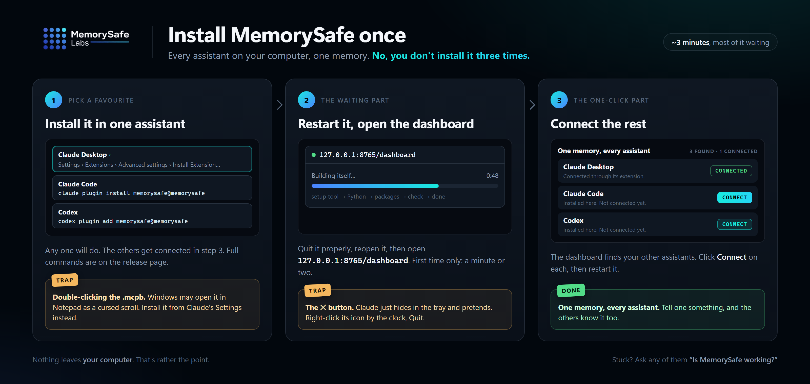

# MemorySafe 0.5.2

Private, governed memory for Claude Code, Claude Desktop and Codex, kept in one SQLite
file on your own computer. macOS, Linux and Windows. Free, and open source under the
Apache License 2.0.

https://github.com/user-attachments/assets/b5128691-64db-48bb-b12c-c9a34d58fda5

## Before you start

Whatever you install below: **restart the assistant afterwards.** Its first start then
builds a private Python runtime. It takes a minute or two, and only happens once. Within seconds,
<http://127.0.0.1:8765/dashboard> shows that setup's progress on this computer, and it turns
into your dashboard when setup finishes. That page is how you know it worked.

## One install, every assistant

Install MemorySafe in whichever assistant you use most, using its section below. Then open
<http://127.0.0.1:8765/dashboard>. It finds the other assistants on this computer and asks once
whether to connect them to the same memory. Say yes and it connects them, each through its own
installer, and connects any you install later too. Remove MemorySafe from one of them later and
it stays removed. Claude Desktop asks you to confirm extensions yourself, so for it the
dashboard's **Connect your assistants** panel shows the one step to take.

From a terminal, `memorysafe connect` shows the same list and changes nothing;
`memorysafe connect --apply` connects them:

    ~/.local/share/MemorySafe/bin/memorysafe connect                  # Linux
    ~/Library/Application\ Support/MemorySafe/bin/memorysafe connect  # macOS
    %LOCALAPPDATA%\MemorySafe\bin\memorysafe.cmd connect              # Windows

## Claude Code

Needs the `claude` command-line tool, which the Claude desktop app does not include. If
`claude --version` doesn't answer in a terminal, install it first:

On macOS and Linux:

    curl -fsSL https://claude.ai/install.sh | bash

On Windows, in PowerShell:

    irm https://claude.ai/install.ps1 | iex

On Windows, open a new terminal afterwards. If `claude` still isn't found, the installer's
last lines say how to add it to your PATH. Then:

    claude plugin marketplace add MemorySafe-Labs/memorysafe-plugin
    claude plugin install memorysafe@memorysafe

Restart Claude Code, run `/mcp`, and confirm `memorysafe` is connected with twelve tools.

The plugin adds two hooks that Claude Code runs on this computer, and neither sends anything
anywhere. One runs when a session starts and hands Claude about a dozen short lines from your
memory: safety notes and your preferences first. The other runs each time you send a message
and reads it there. While automatic capture is off it saves nothing and stays silent; once you
turn it on, it saves a preference you state plainly ("always use Black") itself and reminds
Claude to offer the other lasting facts you stated. A one-off instruction ("don't add tests
yet") is not a preference and is not saved. If you chose "In my cloud account", neither hook
reads or writes the file on this computer. The hooks do not run on Windows.

## Claude Desktop

The desktop app does not include the `claude` command, so the commands above will not
work here. Install the extension instead.

Download https://github.com/MemorySafe-Labs/memorysafe-plugin/releases/latest/download/memorysafe-claude-desktop.mcpb, then in Claude
Desktop choose it from **Settings → Extensions → Advanced settings → Install Extension…**.
Leave the data folder empty so Claude Desktop shares the same store. Don't double-click the
file: on some computers Windows opens it in Notepad, and saving it from there breaks it.

Then restart Claude Desktop and open <http://127.0.0.1:8765/dashboard>. If it loads,
MemorySafe is installed. You do not need to download the extension again.

## Codex

    codex plugin marketplace add MemorySafe-Labs/memorysafe-plugin
    codex plugin add memorysafe@memorysafe

Codex asks you to trust the plugin's hook before running it. MemorySafe works without
it: the hook only makes automatic capture fire more reliably once you turn that on.

## Other MCP clients

Cursor, VS Code, Windsurf and anything else that speaks MCP share the same memory through
one command at a fixed path, rewritten on every start so it follows updates:

    ~/.local/share/MemorySafe/bin/memorysafe-mcp                  # Linux
    ~/Library/Application\ Support/MemorySafe/bin/memorysafe-mcp  # macOS
    %LOCALAPPDATA%\MemorySafe\bin\memorysafe-mcp.cmd              # Windows

Give your client that path as the command to run, with no arguments. It needs MemorySafe
installed in one of the three assistants above first, since it is that plugin's launcher
the command reaches.

## The same memory on every device: MemorySafe Cloud

The plugin keeps your memory on one computer. MemorySafe Cloud gives Claude, ChatGPT,
Codex, Cursor and the other assistants you use one shared memory on every device, hosted
in Montréal. It is available now, and free while we keep improving it. Sign in at
<https://memory.memorysafe.ca/>, then add <https://memory.memorysafe.ca/mcp> to each app;
<https://memory.memorysafe.ca/connect> shows the steps for every one. If you can't get in
yet, write to contact@memorysafe.ca for early access.

## First start

The first time an assistant starts MemorySafe, it downloads uv from GitHub, a Python
build through uv, hash-pinned packages from PyPI, and the tokenizer data it counts tokens
with, all into the MemorySafe folder. That takes a minute or two, once. After that,
nothing leaves this computer, with two exceptions you choose yourself. Connecting another
assistant to MemorySafe: that assistant's own installer then downloads the plugin from GitHub.
Choosing "In my cloud account" on the dashboard and signing in: from then on every memory
your assistants save or search goes to memory.memorysafe.ca, your own account and nothing
else, and the dashboard shows it. The memories already on this computer stay here, and the
assistants no longer read or change them; `memorysafe erase --everything "erase everything"`
removes them for good if you want no copy left.
If the account cannot be reached, the assistant is told so in one sentence and nothing is
changed. Signing out, or choosing "On this computer" again, ends that. On a network that blocks GitHub, set MEMORYSAFE_UV to a uv
you already have, or HTTPS_PROXY to your proxy.

## What MemorySafe decides

Most agent memory tools are built to remember. This one is built to **decide what's worth
keeping** — and to show you its reasoning. Every candidate gets one of four outcomes:

| | |
|---|---|
| **Protect** | high value, kept with the reason on record; it leaves recall only when a later fact replaces it (recorded, and reversible) or you confirm you want it forgotten |
| **Store** | worth keeping |
| **Merge** | you already knew this; fold it in rather than duplicate |
| **Skip** | not stored: automatic capture refused it, or automatic mode is off |

What gets protected without being asked: safety and decision memories always; preferences
and personal context; project notes only when they carry a date, amount, deadline, decision
or constraint. Routine entries -- the third and later memory worded the same apart from its
numbers, like a log line -- are stored but never protected automatically. You can protect or
unprotect any memory yourself (`memorysafe protect <id>`, `memorysafe unprotect <id>`, or ask
your assistant); forgetting a protected memory needs confirmation.

When a later fact changes a date, time, amount or version on the same subject, or says so
outright ("moved to", "switched from X to Y", "now"), it replaces the older one, recorded and
reversible. A lower-confidence write, such as an agent's guess, never silently replaces a fact
you stated: both stay, flagged. Search marks every memory that sits in an open conflict and
shows its confidence. To undo a wrong update in one step:
`memorysafe resolve-conflict <id> revert --confirm`. `memorysafe review-conflicts`,
`forget` and `restore` are available as commands too.

Optional capacity limit: set `MEMORYSAFE_MAX_ACTIVE` to cap how many memories stay in active
recall. It is off unless you set it. Over the limit, MemorySafe moves the least valuable
unprotected memories out of recall -- routine, never-recalled, low-importance and oldest first --
records each one in its history, and `restore` brings any of them back. Protected memories are
never moved out. Both sides of an unresolved conflict also remain available until
review. This is a soft target: protected memories and open conflicts can keep the
active count above it. After resolution, later writes can evict eligible records.

A memory health score reports how well the store is doing: importance and confidence at
60%, protection of high-value memories at 30%, duplicate cleanliness at 10%, minus 5 points
for each open conflict (up to 30). The formula is printed with the score, so you can check the
arithmetic rather than trust it.

## What stays local

- One SQLite file serves Claude Code, Claude Desktop and Codex:
  `~/Library/Application Support/MemorySafe/data/memorysafe.sqlite3` on macOS,
  `~/.local/share/MemorySafe/data/memorysafe.sqlite3` on Linux,
  `%LOCALAPPDATA%\MemorySafe\data\memorysafe.sqlite3` on Windows.
- The dashboard is reachable only from this computer.
- MemorySafe does not copy full conversations and does not read an assistant's own memory.

## Off by default

Automatic capture is **disabled** until you explicitly enable it:

> Turn on MemorySafe automatic mode.

Even then, MemorySafe sees only what reaches it: the facts the assistant submits and, in
Claude Code and Codex, the message you just sent, which a hook reads on this computer to save a
plainly stated preference. It keeps no copy of your conversations. Manual saves always require
you to ask.

## What it refuses to store

Automatic capture refuses passwords, API keys, payment or government identifiers, contact
details, precise addresses and medical information. These are refusals, not settings. The
assistant is told to save only lasting facts — not questions, passing remarks, one-off
instructions or guesses about you. These checks recognise shapes, so they are not perfect:
tell the assistant to forget anything that should not have been kept. Keeping other
people's personal details out is a rule the assistant is told to follow; the server does
not yet enforce it.

## Forget, and erase

Forgetting takes a memory out of recall and keeps it, with its history, so it can be
restored. Erasing deletes it for good:

    memorysafe erase <memory id>            # says what would be deleted
    memorysafe erase <memory id> --confirm  # deletes it

An erase removes the memory, the older versions it replaced, their history and the words of
past searches, rewrites the store's file so the text is no longer in it, and deletes the
snapshots and exports that held it. You get a receipt with counts and no text. It cannot reach
what an assistant already received in a conversation, session transcripts, files you saved
elsewhere, or backups of this computer. Assistants cannot erase: it is a command, on purpose.

## Installed MemorySafe by hand before?

Then it is registered twice. Ask your assistant to run MemorySafe's migrate command, or
run it yourself; it shows what it would change and changes nothing without `--apply`:

    ~/.local/share/MemorySafe/bin/memorysafe migrate                  # Linux
    ~/Library/Application\ Support/MemorySafe/bin/memorysafe migrate  # macOS
    %LOCALAPPDATA%\MemorySafe\bin\memorysafe.cmd migrate              # Windows

## Removing MemorySafe

`memorysafe uninstall` takes it back off this computer: the plugins through each
assistant's own installer, the private runtime, the local state, and any hand-written
registration left from an earlier install. It lists what it would remove and changes
nothing without `--apply`:

    ~/.local/share/MemorySafe/bin/memorysafe uninstall                  # Linux
    ~/Library/Application\ Support/MemorySafe/bin/memorysafe uninstall  # macOS
    %LOCALAPPDATA%\MemorySafe\bin\memorysafe.cmd uninstall              # Windows

**Your memories stay** unless you add `--purge`, and a purge copies the database to your
home folder first and prints where. Claude Desktop asks you to confirm what its extensions
do, so removing its extension stays with you: **Settings → Extensions → MemorySafe**.

## Licence

MemorySafe is open source under the [Apache License 2.0](LICENSE): the code here **and every
build we distribute** (Claude Code and Codex plugin, Claude Desktop extension). Install it,
test it, benchmark it, fork it, or bundle it in your own project, MIT-licensed ones included;
nothing else has to be accepted. Keep [LICENSE](LICENSE) and [NOTICE](NOTICE) with any copy
you redistribute.

The MemorySafe name and logo are trademarks and are not part of the licence; the
[trademark policy](TRADEMARKS.md) says what you can do with them without asking (saying your
project uses or bundles MemorySafe is fine). MemorySafe's optional services, such as support, have their own
[Terms of Use](TERMS.md) and [Privacy Policy](PRIVACY.md), and MemorySafe Cloud has its own at
<https://memory.memorysafe.ca/terms> and <https://memory.memorysafe.ca/privacy>; neither limits
your rights under the licence.

## About the numbers

Live token counts are exact measurements of what MemorySafe holds locally. The savings
figure shown next to them is a **modelled estimate**, not anyone's billed usage, and it is
labelled as such wherever it appears.
